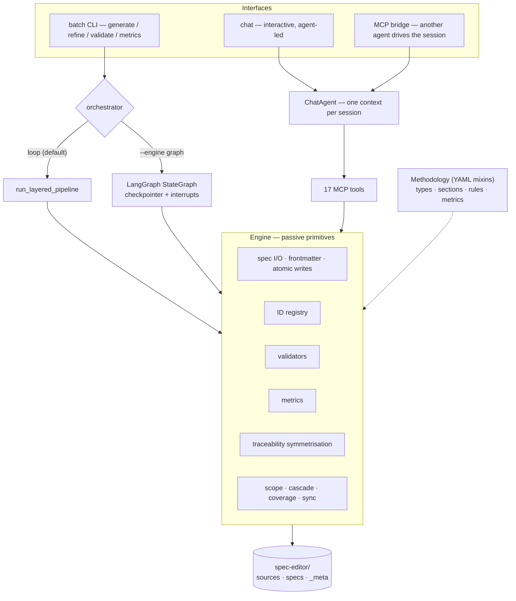

# spec-writer

**An agent-driven specification compiler.** It turns scattered project documents into a
layered, validated, traceable specification corpus — L1 vision → L2 capabilities →
L3 behaviours → L4 technical contracts — that a code-generation agent can consume
deterministically.


---

## Try it in 30 seconds (no API key, no network)

```bash
# from a clone of this repository
python -m venv .venv && source .venv/bin/activate
pip install -e '.[dev]'

spec-writer demo
```

The demo scaffolds a throwaway project, runs the full pipeline against a **scripted
agent** (the same tool handlers a real Claude agent uses), then validates, scores and
walks the traceability tree:

```text
[1/5] Scaffolding demo project at /tmp/demo-output
      source ingested: sources/mini-crm-brief.md

[2/5] Running the graph pipeline against the scripted agent
      + L1-VIS-001
      + L2-CAP-001

[3/5] Files written
      specs/capabilities/manage-the-customer-lifecycle-CAP-001.md
      specs/vision/mini-crm-one-place-for-every-customer-record-VIS-001.md

[4/5] Validation — 2 spec(s), 0 error(s), 0 warning(s)

[5/5] Metrics
      L2-up-to-completeness = 1.00 (target 1.0)
      L2-required-frontmatter = 1.00 (target 1.0)

Traceability — one vision, one capability
      └─ L1-VIS-001 — Mini CRM — one place for every customer record
        └─ L2-CAP-001 — Manage the customer lifecycle

Pipeline: OK — 2 layer(s) converged, 2 spec(s) written
```

Everything the demo exercises — tool dispatch, validation, metrics, traceability —
is the production code path. Only the model is replaced by a deterministic script.

## The problem

Large language models are good at writing specifications and bad at keeping a
*growing* set of specifications coherent. The usual failure modes:

- **Sprawl** — one feature becomes eight files under eight different angles.
- **Context drift** — some requirements are read from raw sources, others from
  already-interpreted specs; the two interpretations diverge silently.
- **No invariants** — nothing enforces that every capability is traced up to a
  vision, or that every behaviour has a test.
- **Unverifiable output** — "the agent wrote 300 files" is not a quality signal.

spec-writer treats specifications as a **compiler problem**: explicit grammar,
layered derivation, mechanical invariants, deterministic file layout — and an LLM
only where judgement is genuinely required.

## Architecture



### Two execution paths, on purpose

| | Chat (`spec-writer chat`) | Batch (`generate` / `refine`) |
|---|---|---|
| Who owns the flow | The **agent** (one context, full session) | An **explicit orchestrator** |
| Engine role | Library of primitives called via tools | Same primitives, driven by a loop or state graph |
| Human in the loop | `ask_user` at any point | `--approve-layers` (graph engine) |
| Use case | Architecture conversations, ambiguous input | CI, scripts, bulk regeneration |

This split is deliberate. Interactive work is not a pipeline — it is a conversation
in which requirements appear, get questioned, and only then get written. Batch work
has no one to converse with, so the orchestration becomes explicit and resumable.

### LangGraph batch engine

`spec-writer generate --engine graph` swaps the hand-rolled convergence loop for a
compiled `StateGraph`:

- **Typed state**, checkpointed after every node (`InMemorySaver` by default;
  any LangGraph checkpointer works).
- **Conditional routing** — `produce → evaluate → (retry | next layer | end)`.
- **Human-in-the-loop** — `--approve-layers` inserts an `interrupt()` before each
  layer; the run suspends and resumes with `Command(resume=approved)`.
- **Shared semantics** — both engines call the same `evaluate_iteration()`, so
  acceptance rules cannot drift apart. A parity test asserts identical results.

```bash
spec-writer generate --engine graph --approve-layers --layer L1 --layer L2
```

## Core ideas

**1. Methodology is data, not code.** Spec types, sections, required frontmatter,
validators, metrics and generation hints live in 32 YAML mixins. `src/spec_writer/`
contains no hardcoded knowledge of "capability" or "api-contract" — swap the mixins
and the engine serves a different methodology.

```yaml
adds_types:
  - id: capability
    layer_name: capabilities
    prefix: CAP
    up_to_types: [vision]
    sections:
      - id: purpose
        title: "Purpose"
        required: true
      - id: actors
        title: "Actors"
        required: false
```

**2. Adjacent-only pyramid.** L(n+1) derives only from L(n). Skip-level references
are rejected by the `pyramid-adjacency` validator, unless the spec type explicitly
declares which parent types are legitimate (`up_to_types`).

**3. Symmetric traceability.** Write one side of a link; the engine maintains the
inverse. `up_to` ↔ `down_to`, `relates_to` ↔ `relates_to`, `depends_on` ↔ `used_by`.
Impact analysis ("what breaks if this vision changes?") falls out of the graph.

**4. Cohesion over fragmentation.** One coherent idea = one file. Test: "if I delete
this file, do I lose a fragment or a whole idea?"

**5. Fail loudly.** No silent fallbacks. Validation runs collect-all, metrics gate
convergence, empty agent output is an error rather than a no-op success.

**6. ID registry, not vibes.** Every spec gets `L<n>-<PREFIX>-<NNN>` from a gap-filling
allocator that scans the corpus on start. Duplicate IDs are impossible by construction.

**7. Vendor-portable agent runtime.** `LLMClient` is a protocol. The default provider
speaks Claude via `claude-agent-sdk` and the Claude subscription; tests use a scripted
`FakeLLMClient`, so the whole suite runs offline.

**8. Another agent can drive it.** `spec-writer.interface.agent_bridge` exposes the
chat agent over stdio MCP (`chat_open` / `chat_send` / `chat_resume` / `chat_close`),
so an orchestrating agent can treat spec-writer as a tool.

## Tool surface (17 MCP tools)

| Group | Tools |
|---|---|
| Write | `record_spec`, `patch_spec`, `delete_spec` |
| Read | `read_spec`, `list_corpus`, `list_sources` |
| Quality | `validate`, `metrics` |
| Traceability | `query_traceability`, `resolve_source_chain`, `resolve_scope` |
| Reverse engineering | `discover_code_inventory`, `coverage_report` |
| Sync | `detect_code_changes`, `build_reverse_index`, `record_sync_complete` |
| Interaction | `ask_user` |

Tools are thin wrappers over engine primitives. The same handlers serve the Claude
agent (over MCP), the offline scripted agent, and unit tests.

## CLI

| Command | What it does |
|---|---|
| `spec-writer init` | Scaffold `spec-editor/` (preset: `minimal`, `default-backend`, `web-product`) |
| `spec-writer demo` | Offline end-to-end demo — no credentials required |
| `spec-writer chat` | Interactive REPL backed by the real agent |
| `spec-writer generate` | Batch generation; `--engine loop\|graph`, `--direction fwd\|rev` |
| `spec-writer refine` | Targeted fixes against validator findings |
| `spec-writer validate` | Read-only validation (no LLM) |
| `spec-writer metrics` | Coverage and quality metrics (no LLM) |
| `spec-writer status` | Corpus and project state |
| `spec-writer usage-report` | Token usage from `_meta/usage/*.jsonl` |
| `spec-writer prompt-debug` | Render the system/user prompts without calling a model |

## Running the real agent

Live mode requires the [Claude Code CLI](https://claude.com/claude-code) and a Claude
subscription (or `ANTHROPIC_API_KEY`):

```bash
spec-writer init --no-wizard --preset web-product
cp my-requirements.md spec-editor/sources-raw/
spec-writer chat
> Generate L1 and L2 for this project, then show me the metrics.
```

Or headless:

```bash
spec-writer generate --layer L1 --layer L2
spec-writer validate && spec-writer metrics
```

## Quality

```bash
make check   # ruff + pyright + pytest
```

- **733 tests** (unit, integration, opt-in smoke), fully offline by default.
- **Pyright** with `strict` mode over the engine, agent, methodology and I/O layers.
- **Ruff** lint + format gates.
- Coverage gate at 80 %.
- CI matrix on Python 3.10 and 3.12.

## Repository layout

```text
src/spec_writer/
├── types.py, config.py          # data model + layered config resolution
├── engine/                      # passive primitives: ids, scope, seed, trace, loop, sync
├── methodology/                 # mixin loader/registry, validators, metrics, built-in YAML
├── io/                          # frontmatter, deterministic paths, atomic writes
├── agent/                       # LLM protocol, Claude provider, 17 tools, ChatAgent
└── interface/
    ├── batch/                   # CLI, commands, LangGraph orchestrator (graph.py)
    └── agent_bridge/            # stdio MCP server to drive the agent from outside
tests/                           # unit · integration · smoke · snapshots
docs/                            # architecture and methodology guides
```

## Design principles (abridged)

1. Pyramidal layering — adjacent-only derivation, configurable number of middle layers.
2. Bidirectional traceability — corpus links are symmetric by construction.
3. Cohesion over fragmentation — one idea, one file.
4. Methodology as configuration — YAML, no engine changes to change the method.
5. One agent per session — chat is a conversation, not a pipeline.
6. Deterministic artefacts — stable IDs, stable file names, canonical frontmatter.
7. Fail loudly — validators and metrics gate; nothing degrades silently.
8. English-only output, tests first, no hidden fallbacks.
9. Tools are what the agent *may* do; hooks are what the engine *must* do.
10. The bottom layer is codegen-ready: two agents reading it should write the same code.

## Status and limitations

- V2 is a **working prototype** (`2.0.0a1`): the engine, agent runtime, CLI, MCP
  bridge and both orchestrators are implemented and tested; it has been piloted on a
  760-spec, four-layer corpus.
- Live mode currently ships one provider (`claude-subscription`); other providers plug
  into the `LLMClient` protocol.
- The reverse (code → specs) direction is implemented as primitives and tools, but the
  batch REV orchestration is less battle-tested than FWD.
- `sync` (detecting code drift and reconciling the corpus) is available as tools and
  chat instructions; a dedicated batch command is on the roadmap.

## License

MIT — see [LICENSE](LICENSE).
